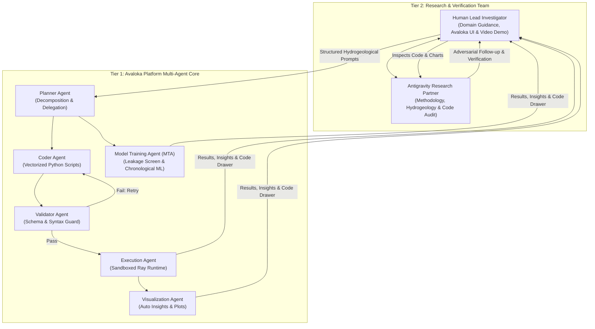

# AGENT ARCHITECTURE & COLLABORATIVE ROLES: GUJARAT GROUNDWATER PROJECT

**Project**: The Monsoon Recharge Gap: Identifying Persistent Groundwater Stress Across Gujarat  
**Framework**: Multi-Agent Collaborative Data Intelligence & Hydrogeological Verification  
**Evaluation Target**: Avaloka AI Engineering Internship Hackathon (Guruvai Sciences)  

---

## 1. The Dual-Tier Agent Framework

This project operates across two complementary agent tiers:
1. **Tier 1: Avaloka Autonomous Digital Workforce (Platform Under Evaluation)**  
   The internal multi-agent graph running within Avaloka ([avaloka.ai](https://avaloka.ai)), responsible for parsing natural language prompts, writing vectorized Python code, validating schema and syntax safety, executing sandboxed compute on Ray clusters, rendering interactive Auto Insights, and training predictive models via the Model Training Agent (MTA).
2. **Tier 2: The Research Team (Human-in-the-Loop Hydrogeological Investigators)**  
   Composed of the **Human Lead Investigator** (Hackathon Participant) and **Antigravity** (Senior Data Science Research Engineer & Hackathon Partner). This tier formulates hydrogeological hypotheses, designs mathematically bounded prompts, audits generated code in Avaloka's Code Drawer, conducts adversarial follow-up queries, and performs independent mathematical verification in a separate sandbox.



---

## 2. Tier 1: Avaloka Internal Agent Roles & Specifications

| Avaloka Agent | Primary Responsibility | Input Triggers | Output Artifacts | Quality / Failure Modes Monitored |
| :--- | :--- | :--- | :--- | :--- |
| **Planner Agent** | Orchestrates user prompts; breaks complex hydrogeological questions into logical DAG stages; selects worker agents. | User natural language prompts via Avaloka UI chat. | Structured execution plan; agent delegation graph. | Misinterpreting domain semantics (e.g., confusing water table depth in mbgl with volumetric storage). |
| **Coder Agent** | Authors high-performance, vectorized Python scripts (Pandas, NumPy, Scipy, Scikit-Learn) to implement the analytical plan. | Subtasks delegated from Planner Agent. | Python scripts, aggregation pipelines, transformation logic. | Inadvertent dataframe mutation; naive zero-filling of missing quarters; target leakage; using parametric mean on skewed distributions. |
| **Validator Agent** | Pre-execution safety and contract gate; validates code syntax against the active groundwater schema. | Python script from Coder Agent. | Validation pass flag or structured error feedback to Coder. | False passes on column name mismatches (e.g., `station_code` vs `station_id`); unchecked memory leaks. |
| **Execution Agent** | Safely executes validated scripts inside sandboxed containerized compute (Ray backend). | Validated Python scripts and active groundwater DataFrame. | Computed metric tables, DataFrames, console outputs. | Out-of-memory errors on large station-year cross joins; execution timeouts. |
| **Visualization Agent** | Translates analytical tables into interactive web charts for the **Auto Insights** pane (up to 5 charts). | Computed data summaries from Execution Agent. | Interactive charts (Plotly / Vega-Lite), metric cards. | Sub-optimal chart selection (e.g., pie charts for 28 districts); inverted Y-axes (depth mbgl must properly show surface at top). |
| **Model Training Agent (MTA)** | Manages end-to-end ML: screens for data leakage, defines chronological train/test splits, proposes training plans, evaluates persistence baselines, exposes inference API. | Model training requests from Planner Agent. | Model Run ID, RMSE, MAE, R², PR-AUC, inference card. | Leakage slippage (using future data); failing to compare against the persistence baseline; random K-fold shuffling across time. |

---

## 3. Tier 2: Research Team Roles & Operational Protocol

### Role A: Human Lead Investigator (Hackathon Participant)
- **Primary Ownership**: Overall project vision, Avaloka account management, UI navigation, dataset upload, screen recording, and final form submission.
- **Workflow Actions**:
  - Uploads sanitized groundwater dataset (`gujarat_groundwater_analytical.csv`) to the Avaloka web interface.
  - Submits the refined prompt sequences into Avaloka's chat.
  - Opens code drawers to inspect generated Python scripts.
  - Performs the 2-minute screen recording and audio voiceover according to `DEMO_PLAN.md`.
  - Submits the final Google Form before Sunday 11:59 PM IST.

### Role B: Antigravity (Senior Data Science Research Engineer & Hackathon Partner)
- **Primary Ownership**: Methodological rigor, mathematical formulation, hydrogeological domain modeling, prompt engineering, code auditing, adversarial challenge design, and verification script authoring.
- **Workflow Actions**:
  - Authors the end-to-end analytical and machine learning protocols.
  - Formulates structured, mathematically unambiguous prompts for Avaloka.
  - Audits Avaloka's generated Python scripts for statistical hygiene, proper datetime parsing, and anti-leakage compliance.
  - Formulates targeted adversarial follow-up queries to challenge counter-intuitive AI outputs (e.g., verifying Simpson's Paradox on Saurashtra vs North Gujarat).
  - Drafts and executes independent sandboxed cross-checking scripts to verify headline numbers against raw CGWB/NWIC data.
  - Authors the publication-grade final report structure and executive syntheses.

---

## 4. Multi-Agent Handshake & Review Protocol

To ensure full transparency and auditability, every interaction follows a documented 4-step handshake:

```
[Prompt Design]      Antigravity crafts bounded hydrogeological prompt targeting specific hypothesis.
         │
         ▼
[UI Execution]       Human Lead enters prompt into Avaloka; observes Planner & Coder in real-time.
         │
         ▼
[Code & Output Log]  Human Lead captures Avaloka's generated Python script and output tables.
         │
         ▼
[Peer Audit]         Antigravity audits code for hygiene; if anomaly found, generates 
                     adversarial follow-up prompt to challenge Avaloka's finding.
```
