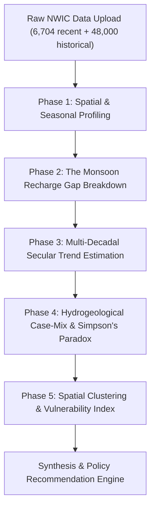

# ANALYTICAL EXECUTION PLAN: GUJARAT GROUNDWATER RECHARGE GAP

**Project**: The Monsoon Recharge Gap: Identifying Persistent Groundwater Stress Across Gujarat  
**Platform Under Evaluation**: Avaloka AI Multi-Agent Platform ([avaloka.ai](https://avaloka.ai))  
**Data Sources**: Central Ground Water Board (CGWB) & National Water Informatics Centre (NWIC / NWDP, Ministry of Jal Shakti)  

---

## 1. Hydrogeological Foundation & Analytical Premise

In semi-arid and hard-rock terrains like Gujarat, groundwater dynamics are dictated by a stark hydrological asymmetry:
1. **Four-Stage Seasonal Cycle**:
   - **Pre-Monsoon Baseline (May)**: Maximum annual depletion following Rabi irrigation and summer evapotranspiration. Water levels reach annual lowest elevation ($h_{\text{May}}$ reaches peak depth in mbgl).
   - **Mid-Monsoon Infiltration (August)**: Early aquifer response and soil moisture saturation following South-West monsoon onset (June–July).
   - **Post-Monsoon Peak Storage (November)**: Maximum annual recharge and water table recovery ($h_{\text{Nov}}$ reaches minimum depth in mbgl).
   - **Post-Rabi Drawdown (January)**: Mid-winter extraction stress driven by wheat, mustard, and cumin cultivation.

2. **The Four Hydrogeological Zones of Gujarat**:
   - **North Gujarat Alluvium (Mehsana, Patan, Banaskantha, Gandhinagar)**: Deep multi-layered confined/unconfined alluvial aquifers. Known for deep tube-well mining ($>60\text{--}150\text{ mbgl}$), low direct recharge rates, and extensive cone-of-depression drawdown.
   - **Saurashtra Hard-Rock Basalts (Rajkot, Junagadh, Jamnagar, Amreli, Bhavnagar)**: Deccan Trap basalts characterized by secondary porosity (fractures, joints, vesicles). High recharge transmissivity during monsoon, but extremely low specific yield ($S_y \approx 1\text{--}3\%$), causing steep post-monsoon depletion.
   - **Kachchh Arid Sedimentary Basin (Bhuj, Mandvi, Rapar)**: Mesozoic sandstones and Tertiary formations. Arid climate with highly erratic monsoon precipitation and coastal salinity ingress.
   - **South Gujarat Coastal & Alluvial Plains (Surat, Navsari, Valsad, Bharuch)**: High-rainfall coastal plain with shallow water tables, seasonal waterlogging, and localized industrial/aquacultural extraction.

---

## 2. Mathematical Metric Definitions

Groundwater elevation measurements in CGWB/NWIC datasets are reported as **Depth to Water Level ($h$) in meters below ground level (mbgl)**.  
*Crucial Orientation Rule*: A larger numeric value signifies a **deeper, more depleted water table**, whereas a smaller numeric value signifies a **shallow, replenished water table**.

$$\begin{aligned}
\text{Monsoon Recharge Delta } (\Delta h_{\text{recharge}}) &= h_{\text{May}} - h_{\text{Nov}} \quad (\text{meters}) \\
&\quad \text{where } \Delta h > 0 \implies \text{Water table rose (recharged)} \\
&\quad \text{where } \Delta h \le 0 \implies \text{Water table failed to rise (Recharge Gap)} \\[10pt]
\text{Post-Monsoon Depletion Rate } (\Delta h_{\text{depletion}}) &= h_{\text{Jan}} - h_{\text{Nov}} \quad (\text{meters of drawdown during early Rabi}) \\[10pt]
\text{Inter-Annual Drift } (\Delta h_{\text{annual}}) &= h_{\text{May}, t+1} - h_{\text{May}, t} \quad (\text{net change across consecutive summers}) \\[10pt]
\text{Recharge Recovery Ratio } (RRR) &= \frac{\Delta h_{\text{recharge}}}{h_{\text{May}} - \min(h_{\text{all\_history}})}
\end{aligned}$$

### Critical Classification Thresholds (CGWB / GWRDC Standards):
- **Over-Exploited / Severely Stressed**: $h > 20.0 \text{ mbgl}$ (or regional upper decile $P_{90}$).
- **Monsoon Recharge Failure (Acute Gap)**: $\Delta h_{\text{recharge}} \le 0.0 \text{ m}$ despite recorded district monsoon rainfall $> 500\text{ mm}$.
- **Sub-optimal Recharge**: $0.0 < \Delta h_{\text{recharge}} < 1.0 \text{ m}$.
- **Healthy Monsoon Recovery**: $\Delta h_{\text{recharge}} \ge 2.5 \text{ m}$.

---

## 3. Five-Phase Analytical Workflow for Avaloka

The analysis is structured into 5 sequential phases designed to be executed via Avaloka's natural language interface, inspecting the generated code and agent logs at each stage.



### Phase 1: Spatial & Seasonal Profiling
- **Analytical Objective**: Establish baseline distribution of water table depths across all 28 districts and 4 quarterly monitoring cycles (January, May, August, November).
- **Key Statistics to Compute**:
  - Parametric: Mean, standard deviation.
  - Non-parametric: Median, Interquartile Range (IQR, $P_{25}\text{--}P_{75}$), 90th percentile ($P_{90}$), 99th percentile ($P_{99}$).
  - Grouped aggregations: District $\times$ Season table.
- **Expected Avaloka Agent Action**: Coder Agent writes vectorized Pandas `.groupby(['district', 'quarter'])['depth'].describe()` and generates boxplots/heatmaps via Visualization Agent.

### Phase 2: The Monsoon Recharge Gap Investigation
- **Analytical Objective**: Pair May (Pre-Monsoon) and November (Post-Monsoon) records for identical monitoring stations within the same hydrological year to calculate $\Delta h_{\text{recharge}}$.
- **Core Investigation Questions**:
  1. What proportion of monitoring stations show a **negative or zero recharge delta** ($\Delta h \le 0$)?
  2. Which districts exhibit the highest prevalence of recharge gaps?
  3. Does recharge magnitude correlate with pre-monsoon depth (do deep aquifers recharge more when rain falls, or does low infiltration prevent recovery)?
- **Statistical Test**: Spearman rank correlation between $h_{\text{May}}$ and $\Delta h_{\text{recharge}}$.

### Phase 3: Decadal Secular Trends (1991–2020 vs 2021–2025)
- **Analytical Objective**: Determine whether observed groundwater stress in recent years is an acute cyclical artifact of recent rainfall variations or part of a secular 30-year multi-decadal decline.
- **Methodology**:
  - Non-parametric Mann-Kendall Trend Test for monotonic trend significance ($p < 0.05$).
  - Theil-Sen Median Slope estimator ($\beta_{\text{Sen}}$ in $\text{meters/year}$) for robust trend magnitude resistant to seasonal outliers.
  - Station-level filtering: Restrict trend calculations to stations with $\ge 15$ years of continuous records to avoid attrition bias.

### Phase 4: Hydrogeological Case-Mix & Simpson's Paradox Investigation
- **Analytical Objective**: Challenge naive aggregate metrics that obscure opposing regional geological realities.
- **Hypothesis**: Statewide aggregate recharge numbers may indicate healthy post-monsoon recovery ($\overline{\Delta h} > 2\text{ m}$), but stratifying by hydrogeological rock type (Alluvial vs Hard Rock Basalt) will reveal:
  - *Hard Rock (Saurashtra)*: High seasonal recharge ($\Delta h > 3.5\text{ m}$) but rapid post-monsoon depletion by January ($\Delta h_{\text{Rabi}} > 3.0\text{ m}$) due to negligible aquifer storage volume.
  - *Alluvial Plains (North Gujarat)*: Negligible seasonal recharge ($\Delta h < 0.8\text{ m}$) paired with permanent multi-decadal depression ($h > 40\text{ mbgl}$).
  - *Simpson's Reversal*: Districts with the highest absolute water recharge delta can experience the most severe pre-monsoon drinking water failures due to low retention capacity.

### Phase 5: Spatial Clustering & Groundwater Vulnerability Index (GVI)
- **Analytical Objective**: Construct a composite, defensible vulnerability index to classify talukas/districts into operational priority tiers for intervention.
- **Metric Formulation**:
  $$\text{GVI}_i = w_1 \cdot \widetilde{h}_{\text{May}} + w_2 \cdot \widetilde{\text{GapProb}} + w_3 \cdot \widetilde{\beta}_{\text{Sen}} + w_4 \cdot \widetilde{\text{Drawdown}}_{\text{Rabi}}$$
  where variables are min-max normalized across stations, and weights sum to 1.0.
- **Clustering**: K-Means / Agglomerative clustering on spatial coordinates and vulnerability features to segment Gujarat into 4 discrete management zones:
  1. *Zone 1: Acute Mining & Permanent Depletion* (North Gujarat Alluvium).
  2. *Zone 2: Flash Recharge & High Rabi Vulnerability* (Saurashtra Basalts).
  3. *Zone 3: Arid Salinity Ingress Risk* (Kachchh Coastal/Sedimentary).
  4. *Zone 4: Stable / Shallow Fluctuations* (Central & South Gujarat).

---

## 4. Prompt Playbook for Avaloka Multi-Agent Engine

To ensure rigorous multi-agent execution in Avaloka, prompts must be clear, mathematically explicit, and contain concrete verification checks.

### Prompt 1: Data Health, Geocoding & Seasonal Profile
```text
Dataset: Gujarat Groundwater Monitoring Levels (CGWB/NWIC).
1. Inspect the dataset schema, confirm date column 'data_collection_date', extract 'year', 'month', and define season categories:
   - January: 'Post-Monsoon Rabi'
   - May: 'Pre-Monsoon Summer'
   - August: 'Mid-Monsoon'
   - November: 'Post-Monsoon Kharif'
2. Filter valid depth values (where depth >= 0 and depth <= 250 mbgl). Report the count of missing or anomalous depths.
3. Compute the median, IQR, and 90th percentile of depth (mbgl) grouped by district and by season.
4. Visualize a grouped bar chart or heatmap comparing median depth across districts for May vs November.
```

### Prompt 2: Computing the Monsoon Recharge Delta & Deficit Stations
```text
For each unique monitoring station (identified by 'station_code' and 'district') and for each hydrological year:
1. Identify the May pre-monsoon depth (h_may) and November post-monsoon depth (h_nov).
2. Calculate the Monsoon Recharge Delta: Delta_h = h_may - h_nov (in meters). Note: A positive value indicates the water table rose (recharged), while a negative value indicates deepening (recharge deficit).
3. Compute the proportion of monitoring stations in each district that experienced a Recharge Deficit (Delta_h <= 0).
4. Identify the top 5 districts with the highest fraction of recharge-deficit stations.
5. Create a scatter plot of h_may (x-axis) vs Delta_h (y-axis) colored by district, adding a horizontal reference line at Delta_h = 0.
```

### Prompt 3: Secular 30-Year Trend Analysis (Historical Comparison)
```text
Using the historical groundwater records:
1. Filter for monitoring stations with at least 15 distinct annual pre-monsoon (May) observations.
2. For each eligible station, calculate the annual rate of groundwater level change using the Theil-Sen slope estimator.
3. Summarize the distribution of trends by district: percentage of stations with significant declining trends (p < 0.05), stable trends, and rising water levels.
4. Plot a choropleth or ranked horizontal bar chart of the median annual water table decline rate (meters per year) by district.
```

### Prompt 4: Investigating Hydrogeological Case-Mix (Simpson's Paradox)
```text
Investigate whether aggregate district recharge statistics mask geological differences between Alluvial and Hard Rock formations:
1. Classify districts into two hydrogeological regimes:
   - Alluvial Plains: Mehsana, Patan, Banaskantha, Gandhinagar, Ahmedabad.
   - Hard Rock / Basalt: Rajkot, Junagadh, Jamnagar, Amreli, Bhavnagar, Surendranagar.
2. For both groups, compute:
   - Median pre-monsoon depth (May)
   - Median monsoon recharge delta (May to Nov)
   - Median post-monsoon Rabi drawdown (Nov to Jan)
3. Check whether Hard Rock stations show greater seasonal recharge but simultaneously suffer faster seasonal depletion than Alluvial stations. Show the tabular breakdown and a comparative boxplot.
```

---

## 5. Code Drawer Inspection Protocol

When Avaloka's Coder and Validator agents produce executable code, Tier 2 (Antigravity & Lead Investigator) will verify:
1. **Datetime Alignment**: Ensure May and November measurements are paired strictly within the same hydrological year ($t$), avoiding lag misalignment across disjoint observation years.
2. **Missing Station Handling**: Verify that wells missing May or November readings in a specific year are dropped via inner join or pair-masking rather than zero-filled (which would falsely report $\Delta h = \pm h$).
3. **No Target Leakage in Feature Pipelines**: Confirm that when calculating risk of pre-monsoon stress for year $t+1$, no post-monsoon observations from year $t+1$ or future rainfall totals are included.
4. **Outlier Auditing**: Confirm whether extreme depths ($> 150\text{ mbgl}$) in Mehsana/Patan reflect genuine deep alluvial tube-wells (CGWB exploratory wells) rather than measurement entry errors.

