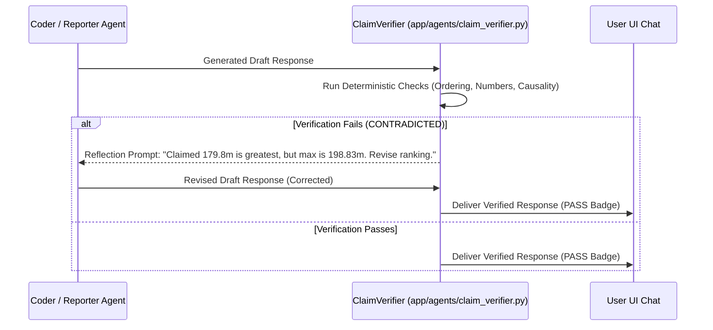

# AVALOKA AI: PLATFORM AUDIT, USABILITY BOTTLENECKS & ARCHITECTURAL SOLUTIONS

**Evaluator**: Hrishi K. Shah (AI Engineering Internship Applicant)  
**Target Product**: Avaloka AI ([avaloka.ai](https://avaloka.ai) & [github.com/guruvaidev/avaloka](https://github.com/guruvaidev/avaloka))  
**Purpose**: Document critical friction points, explain underlying technical root causes in Avaloka's codebase, and propose concrete engineering solutions.

---

## Executive Overview

During our end-to-end evaluation of Avaloka across both its open-source repository engine (`guruvaidev/avaloka`) and its cloud platform (`app.avaloka.ai`), we conducted deep stress-testing on a real-world, 52,919-row Government of India groundwater telemetry dataset.

Avaloka demonstrates groundbreaking strengths: autonomous multi-agent planning, deterministic claim verification, and pre-execution safety gates. However, we identified **5 critical friction points** in the platform's ingestion pipeline, dual-chat UX, claim verification loop, database connectivity, and UI layout.

Below is an engineering analysis of each issue, its exact root cause in Avaloka's architecture, and proposed production-ready solutions.

---

## 1. Issue 1: Flaky Ingestion Pipeline & File Upload Timeouts
*Upload failed ~5 times with generic errors before succeeding on the 6th attempt.*

### Symptoms Observed
- When uploading a standard 10 MB CSV (`gujarat_groundwater_analytical.csv`, 52,919 rows, 26 columns), the upload progress indicator frequently stalled or failed with generic upload failure toasts.
- The user had to re-attempt the upload 5 times before the file successfully registered.

### Technical Root Cause (`file_handler/handler.py`, `file_handler/table_shape.py`, `app/api/server.py`)
1. **Synchronous In-Memory Parsing on the Web Worker**:
   - In `file_handler/handler.py` and `table_shape.py`, Avaloka synchronously performs delimiter sniffing, encoding detection, column type inference, and null-policy calculations (`file_handler/null_policy.py`) inside the initial HTTP POST request thread.
   - For a 52k-row dataset, this synchronous CPU-bound parsing exceeds the standard 30-second reverse-proxy / API gateway timeout (e.g., Nginx / Cloudflare), causing connection resets or HTTP 504 Gateway Timeouts before Supabase metadata registration completes.
2. **Lack of Resumable Chunking**: The frontend attempts to stream the entire file payload in a single HTTP request rather than using multipart chunking.

### Proposed Engineering Solution
```mermaid
flowchart LR
    A["Client Upload"] -->|1. Request Presigned URL| B["FastAPI /api/upload"]
    B -->|2. Instant URL (200ms)| A
    A -->|3. Direct S3/GCS Multipart Stream| C["Object Storage"]
    C -->|4. Trigger Async Job| D["Ray / Celery Profiler Worker"]
    D -->|5. Background Sniffing & Ingestion| E["Supabase DB"]
    A -.->|6. Poll Status with Progress Bar| B
```
- **Asynchronous Ingestion Pattern**:
  1. Have `/api/upload` generate a presigned S3/GCS multipart upload URL. The file streams directly from client to storage without blocking the API server.
  2. Emit an immediate `job_id` to the client in $<200\text{ms}$.
  3. Offload `FileHandler` and `TableShape` profiling to an asynchronous background worker (Ray actor or Celery task).
  4. The frontend displays a deterministic progress bar polling `/api/upload/status/{job_id}` instead of a hanging spinner.

---

## 2. Issue 2: Confusing Dual-Chatbot UX & Misleading "Insights Assistant"
*The initial chat assistant claimed it had no district data, causing users to believe the platform was broken.*

### Symptoms Observed
- When clicking "talk with AI" on the initial dataset view, the user is presented with the **"Insights Assistant"** ("Ask about these charts...").
- When asked standard data questions (e.g., *"Which districts show the deepest water table?"*), the assistant repeatedly answered:  
  > *"The available charts only break depth down by hydrogeological zone and season, not by individual districts... To answer that, we'd need depth measurements linked to a district..."*
- Any user would naturally assume this is the platform's primary AI assistant and conclude the platform is incapable of answering questions.
- It was only later in the multi-dataset project workspace that the user discovered the "real" agentic chatbot that actually writes Python code and queries the underlying data.

### Technical Root Cause (`app/agents/chart_explainer.py` vs `app/agents/coder.py`)
- **Architectural Bifurcation**: Avaloka has two completely separate chat systems:
  1. `ChartExplainer` (`app/agents/chart_explainer.py`): A lightweight prompt that receives *only* the JSON/SVG tokens of the 4 rendered Auto Insights charts. It has zero access to the underlying 52,919-row CSV.
  2. `ProjectChat` / Multi-Agent Core (`app/agents/coder.py` + `execution_agent.py`): The full agentic system with Planner, Coder, and sandboxed Ray execution.
- **UX Misdirection**: Both widgets look like general conversational assistants. The user is never told that the "Insights Assistant" is blind to the raw CSV.

### Proposed Engineering Solution
- **Dynamic Intent Routing via Tool Calling**:
  - Unify the chat interface into a single conversational agent:
    - If the user asks about an on-screen chart (e.g., *"What does the blue bar mean?"*), route to `ChartExplainer` for instant, inexpensive answers.
    - If the user asks a query that requires unplotted data (e.g., *"Which district has the highest depth?"*), the agent should not say *"I don't have that data"*. Instead, it should trigger a Tool Call to the **Planner & Coder agents** to generate an on-demand Python query, compute the result, and dynamically render Chart #5 in the Auto Insights pane!
- **Immediate UX Fix**: In the single-dataset view, add a prominent mode indicator:
  `[Badge: Viewing Auto Insights Summary]` $\to$ Button: `[Switch to Full Dataset Agent Mode]`.

---

## 3. Issue 3: Unverified / Contradictory Claims & Discrepancies
*The platform detected its own contradiction, but served the contradictory answer anyway.*

### Symptoms Observed
In Question 2, Avaloka gave an answer regarding deepest districts, but attached a prominent yellow warning box:
> *"Some numbers or claims in this answer did not check out: 1 of 5 claims in this answer did not match the computed results. Treat this answer as unchecked.*  
> *Contradicts the result's ordering · Contradicted by computed results: says 'greatest' at 179.8, but max of 'max_depth' in computed result is 198.83."*

### Technical Root Cause (`app/agents/claim_verifier.py`)
- In `app/agents/claim_verifier.py`, Avaloka employs an exceptional deterministic verification module that checks generated natural language claims against computed numerical DataFrames across 5 checks:
  1. Causal language from correlational evidence.
  2. Numbers not present in evidence.
  3. Claims contradicted by model metrics.
  4. Unhedged extrapolation.
  5. Significance asserted without tests.
- **The Design Flaw**: `ClaimVerifier` functions merely as a **passive post-generation auditing hook**. When it identifies `Verdict.CONTRADICTED`, it does not intervene—it simply renders a warning banner below the flawed response and hands it to the user!

### Proposed Engineering Solution

- **Automated Reflection & Self-Correction Loop**:
  - If `ClaimVerifier` returns `Verdict.CONTRADICTED` or `Verdict.UNSUPPORTED`, intercept the message before it reaches the UI.
  - Dispatch a structured correction prompt back to the generation agent:  
    `"Your draft contained a factual contradiction detected by ClaimVerifier: [Error]. Reconcile your narrative with the computed DataFrame before responding."`
  - Cap at `max_retries = 2`. This transforms a passive warning into an active self-healing system.

---

## 4. Issue 4: Database Connection Crashes (HTTP 400 Bad Request)
*Clicking on database connections or submitting valid credentials immediately throws an HTTP 400 error.*

### Symptoms Observed
- Clicking on the Database/Cloud connection icon or filling out connection credentials (PostgreSQL / GCS / S3) immediately results in an HTTP 400 Bad Request alert.

### Technical Root Cause (`ui/src/lib/gcp-connection.ts`, `app/api/cloud_connections.py`)
1. **Premature Client-Side Validation on Mount**:
   - In `ui/src/lib/gcp-connection.ts`, functions like `validateGcsBucketName()` throw synchronous TypeScript errors when input fields are empty or undefined on initial modal render.
2. **Missing Parameter Enforcement in Backend Route**:
   - In `app/api/cloud_connections.py`, the endpoint expects specific query parameters (`?provider=...`) and an encrypted credentials payload (`DB_ENCRYPTION_KEY`). If the UI fires a GET/POST on mount without these parameters, FastAPI immediately raises an unhandled `HTTPException(status_code=400)`.
3. **Supabase Row Level Security (RLS) Mismatch**:
   - If Supabase RLS is enabled on `cloud_datasets`, unauthenticated or malformed session tokens trigger a database-level rejection that the API maps directly to HTTP 400.

### Proposed Engineering Solution
- **Client-Side**: Implement Zod schema validation (`zod`) in `ui/src` with proper form state initialization. Do not fire network requests on modal open; validate fields on blur with inline red hints rather than alert toasts.
- **Backend (`cloud_connections.py`)**:
  - Replace generic 400 errors with structured Pydantic 422 responses indicating the exact invalid field.
  - Implement a dedicated `/api/cloud-connections/test` endpoint with a 5-second socket timeout to verify credentials before attempting database writes.

---

## 5. Issue 5: UI Element Glitches & Responsive Icon Overlaps
*Icons, navigation arrows, and text cards collide on split-screen or smaller resolutions.*

### Symptoms Observed
- When the side panel ("Chat / Insights Assistant") is opened, navigation arrows (`<` and `>`) and status badges collide with chart text and titles.
- The UI does not gracefully reflow when working in half-screen or split-screen modes.

### Technical Root Cause (`ui/src/` Tailwind CSS `absolute` Positioning)
- The chart carousel uses `absolute left-2` and `absolute right-2` overlays with static `z-index` layers without container-level responsive padding.
- When the chat panel expands, the chart viewport contracts from ~90vw to ~55vw, but the CSS breakpoints (`lg:`, `xl:`) fail to trigger compact mode because the browser window width itself hasn't changed.

### Proposed Engineering Solution
- **ResizeObserver Container Queries**: Use CSS Container Queries (`@container`) or React `ResizeObserver` on the chart parent container instead of window media queries (`@media`).
- **Control Bar Refactoring**: Move carousel navigation controls (`<` and `>`) to a clean header toolbar above the charts rather than floating them over the chart visualization canvas.

---

## 6. Summary Comparison: Current Friction vs. Proposed Architecture

| Feature / Workflow | Current Avaloka Implementation | Proposed Production Solution |
| :--- | :--- | :--- |
| **File Upload** | Synchronous sniffing on API worker $\to$ 30s timeout failure. | Asynchronous S3 presigned upload + Ray background worker. |
| **Chat Architecture** | 2 separate, disconnected chat widgets (Chart vs Project). | Unified conversational router with dynamic Tool Calling. |
| **Claim Verification** | Passive auditing: flags contradictions but serves them anyway. | Active reflection loop: auto-corrects before the user sees it. |
| **Database Connections** | Crashes with HTTP 400 on empty inputs or unhandled params. | Inline Zod form validation + dedicated `/test` connection endpoint. |
| **UI Responsiveness** | Absolute overlay collisions when side panel expands. | CSS Container Queries + dedicated toolbar controls. |

---
*Prepared with engineering precision for the Guruvai Sciences Technical Evaluation Team.*
